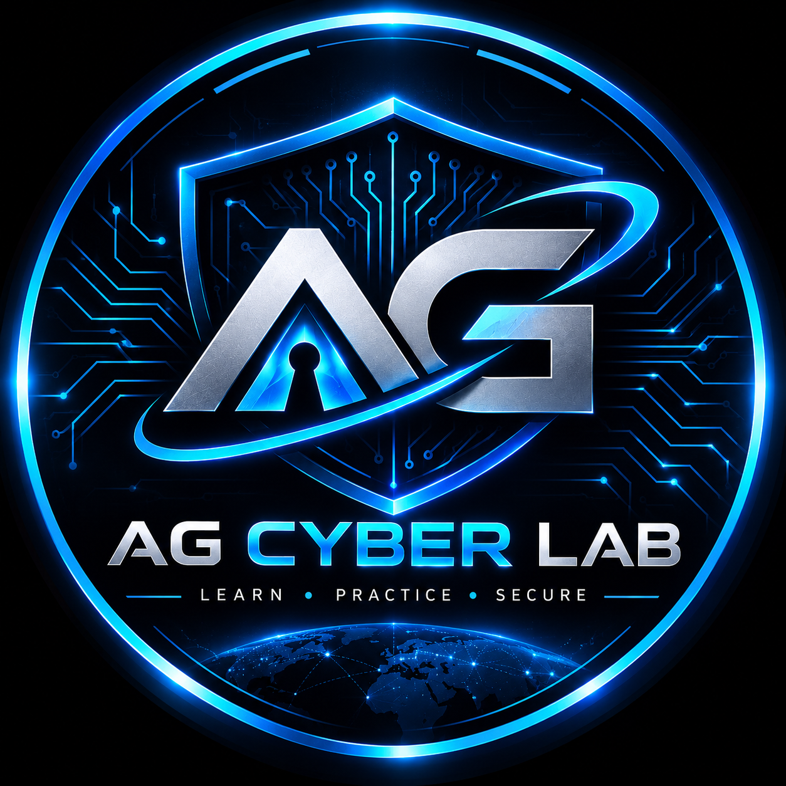
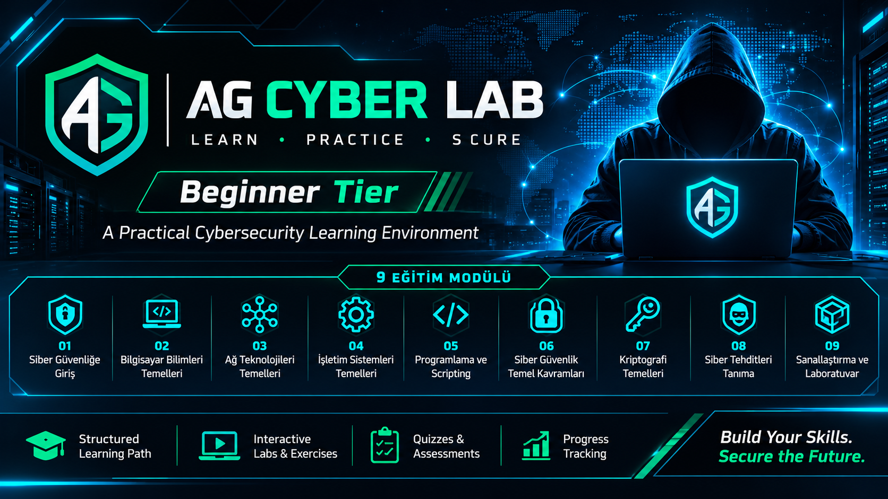
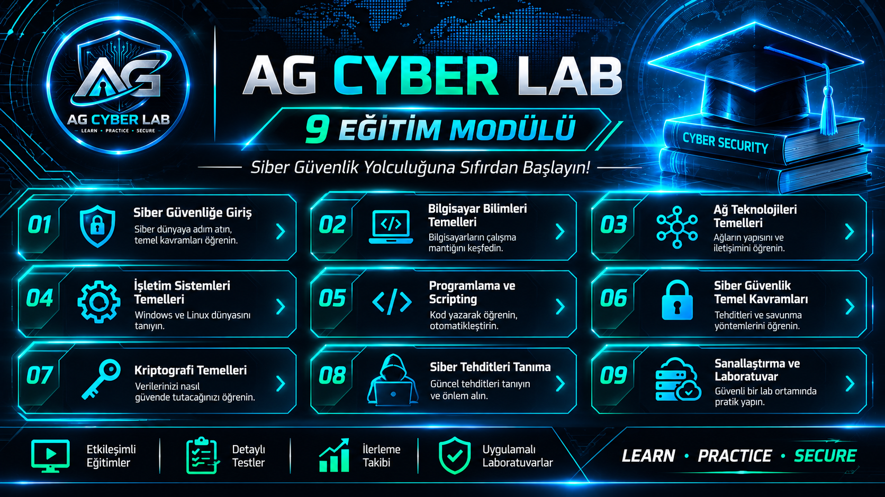
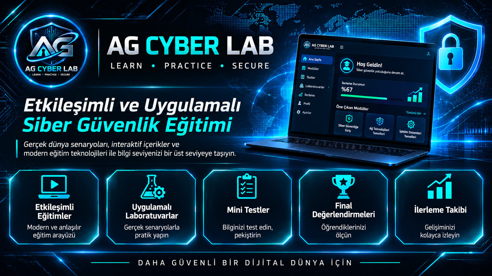
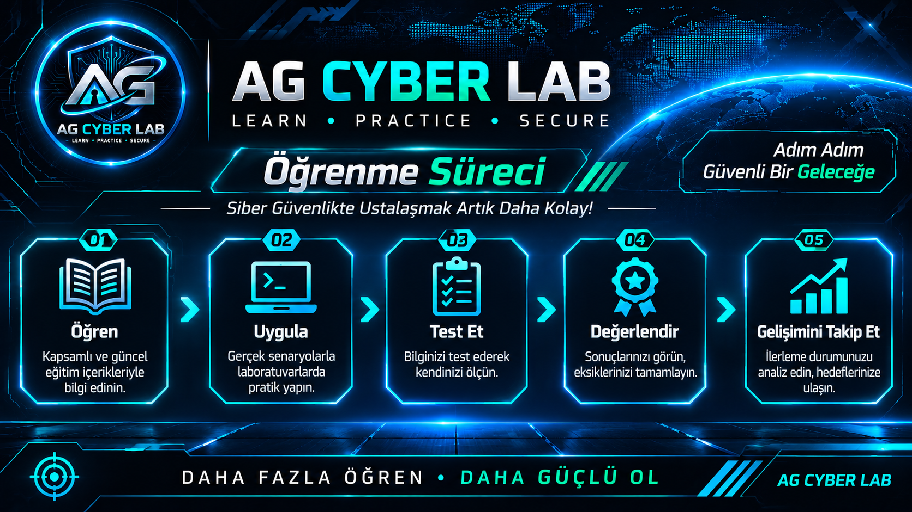

# AG CYBER LAB — Beginner Tier

<p align="center">
  
</p>

<h1 align="center">LEARN • PRACTICE • SECURE</h1>

<p align="center">
  <strong>A Practical, Local-First Cybersecurity Learning Experience</strong>
</p>

<p align="center">
  <a href="README.md">English</a> · <a href="README.tr.md">Türkçe</a>
</p>

<p align="center">
  
</p>

---

## About the Project

**AG CYBER LAB – Beginner Tier** is a structured cybersecurity learning project designed to help beginners build a strong foundation in cybersecurity and related technical disciplines.

The project brings together **9 independent educational modules** covering computer science, networking, operating systems, programming, cybersecurity concepts, cryptography, cyber threats, and virtualization.

Each module is a separate application that can be installed and launched locally on the learner's computer.

Our mission is to make cybersecurity education more accessible through structured learning, interactive experiences, and practical exploration.

## Project Highlights

| Feature | Description |
|---|---|
| 9 Independent Modules | A structured beginner-level curriculum |
| 110 Lesson Titles | A broad range of foundational topics |
| Interactive Learning | Interactive educational components and activities |
| Knowledge Assessments | Mini quizzes and module-level assessments |
| Local Execution | Run the applications on your own computer |
| Independent Projects | Each module has its own project configuration |
| Beginner-Friendly | Concepts introduced progressively |

## Curriculum — 9 Learning Modules

<p align="center">
  
</p>

| No. | Module | Main Topics |
|---|---|---|
| 01 | Introduction to Cybersecurity | Security foundations, security teams, careers and ethics |
| 02 | Computer Science Fundamentals | Computer architecture, hardware, software and data |
| 03 | Networking Fundamentals | Network models, IP addressing, protocols and ports |
| 04 | Operating Systems Fundamentals | Windows, Linux, processes, permissions and command line |
| 05 | Programming and Scripting Fundamentals | Algorithms, Python, Bash, PowerShell and data formats |
| 06 | Core Cybersecurity Concepts | CIA Triad, threats, vulnerabilities, risk and defense |
| 07 | Cryptography Fundamentals | Encryption, hashing, digital signatures and PKI |
| 08 | Recognizing Cyber Threats | Malware, phishing, social engineering and attack concepts |
| 09 | Virtualization and Lab Fundamentals | Virtual machines, hypervisors and isolated lab environments |

## Learning Experience

<p align="center">
  
</p>

The learning experience combines educational explanations with practical and interactive components.

Depending on the module, learners may encounter:

- Structured educational content
- Interactive demonstrations
- Practical exercises and simulations
- Lesson-level knowledge checks
- Module-level assessments
- Learning progress features

The exact features and interface may vary between modules because each application is maintained independently.

## Learning Workflow

<p align="center">
  
</p>

**Learn → Apply → Test → Evaluate → Track Your Progress**

Build your knowledge step by step. Explore concepts, practice with available activities, evaluate your understanding, and continue improving.

## Screenshots

Authentic screenshots of the educational applications will be added here as the visual documentation is completed.

## Technology Stack

The modules intentionally retain their individual technology choices.

- **Next.js** — Used by most modules.
- **React** — Component-based user interfaces.
- **TypeScript** — Typed application development.
- **Vite** — Development tooling used by Module 02.
- **Tailwind CSS** — Utility-first styling in projects that use it.
- **npm** — Dependency installation and project scripts.

The modules are not combined into one application. Each module has its own `package.json` and development scripts.

## Requirements

Before getting started, make sure you have:

- Windows, macOS, or Linux
- A currently supported Node.js LTS release
- npm (included with Node.js)
- A modern web browser
- An internet connection for the initial dependency installation

## Installation & Quick Start

### 1. Download the Repository

Clone the repository:

```bash
git clone <REPOSITORY-URL>
```

Alternatively, download the repository as a ZIP file and extract it.

### 2. Choose a Module

Open the `modules/` directory and select the module you want to study.

### 3. Open a Terminal

Open a terminal inside the selected module's directory.

### 4. Install Dependencies

```bash
npm install
```

### 5. Start the Application

```bash
npm run dev
```

### 6. Open the Local Application

Open the local address displayed in your terminal.

Common development addresses include:

- Next.js: `http://localhost:3000`
- Vite: `http://localhost:5173`

The actual address may differ if the default port is already in use.

**Important:** Each module is independent. Run commands from the selected module directory, not from the repository root. Start one module at a time unless you intentionally configure separate ports.

## Repository Structure

```text
AG-CYBER-LAB-BEGINNER/
│
├── assets/
│   └── images/
│
├── docs/
│
├── modules/
│   ├── 01-siber-guvenlige-giris/
│   ├── 02-bilgisayar-bilimleri-temelleri/
│   ├── 03-ag-teknolojileri-temelleri/
│   ├── 04-isletim-sistemleri-temelleri/
│   ├── 05-programlama-ve-scripting-temelleri/
│   ├── 06-siber-guvenlik-temel-kavramlari/
│   ├── 07-kriptografi-temelleri/
│   ├── 08-siber-tehditleri-tanima/
│   └── 09-sanallastirma-ve-laboratuvar/
│
├── .gitignore
├── CONTRIBUTING.md
├── LICENSE
├── README.md
├── README.tr.md
└── SECURITY.md
```

Each module contains its own application source code, configuration files, dependencies and run scripts.

## Local-First Architecture

AG CYBER LAB Beginner Tier is designed around independent local applications.

- No centralized learner account is required to start a module.
- No hosted AG CYBER LAB platform is required.
- Progress is stored in browser local storage where implemented.
- Clearing browser site data may erase locally saved progress.
- No centralized cloud synchronization is provided by this repository.

Refer to individual module documentation for module-specific behavior.

## Security & Ethical Use

This project is intended for educational purposes.

- Use practical exercises only within their intended educational environment.
- Do not test systems, networks, accounts or services without explicit authorization.
- Never use educational knowledge to access, disrupt or damage systems unlawfully.
- Follow applicable laws and responsible disclosure practices.

For security-related reports, please review [SECURITY.md](SECURITY.md).

## Documentation

- [English Documentation](README.md)
- [Turkish Documentation](README.tr.md)
- [Installation Guide](docs/INSTALLATION.md)
- [Project Structure](docs/PROJECT-STRUCTURE.md)
- [Security Policy](SECURITY.md)
- [Contribution Guidelines](CONTRIBUTING.md)
- [License](LICENSE)

## Contributing

Suggestions, documentation improvements, bug reports and educational contributions are welcome.

Before contributing, please review [CONTRIBUTING.md](CONTRIBUTING.md).

## License

Please review the repository's [LICENSE](LICENSE) file for permitted use, redistribution and commercial-use conditions.

## About AG CYBER LAB

**AG CYBER LAB** is an educational project focused on making cybersecurity concepts easier to understand through structured learning and practical exploration.

**LEARN • PRACTICE • SECURE**

- Instagram: [@agcyberlab](https://www.instagram.com/agcyberlab/)
- Founder: [@ahmetgulerpy](https://www.instagram.com/ahmetgulerpy/)

---

<p align="center">
  <strong>AG CYBER LAB — Beginner Tier</strong>
  <br>
  Learn today. Practice responsibly. Build a safer digital future.
</p>

<p align="center">
  Educational project. Module-specific content, features and implementation details may differ.
</p>