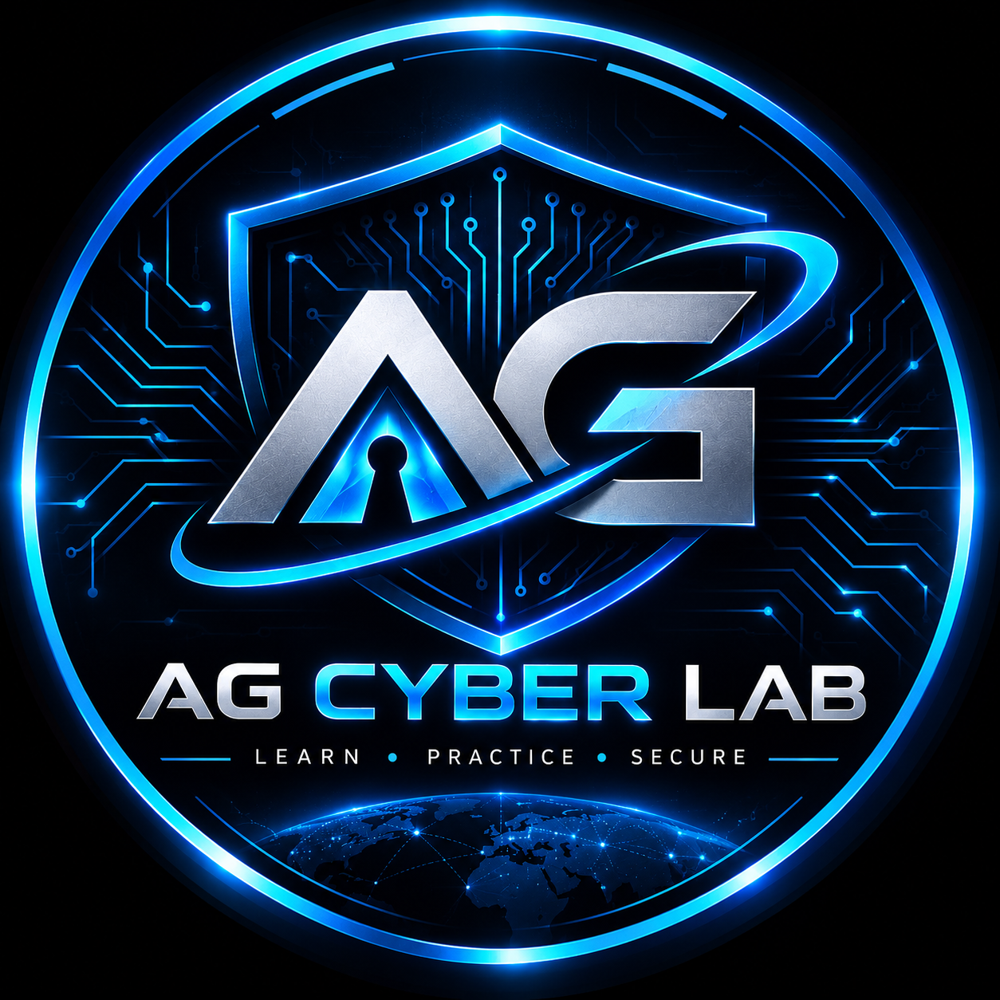
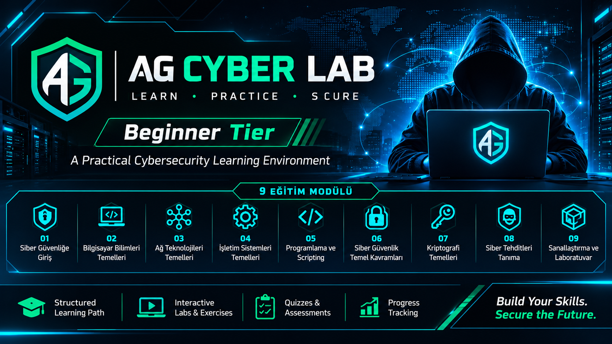
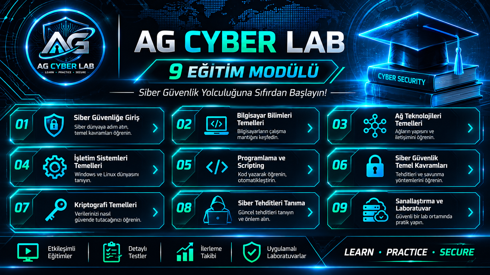
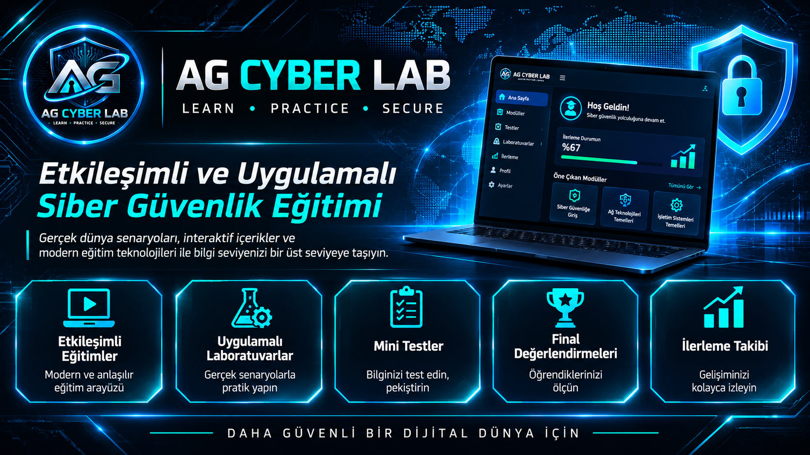
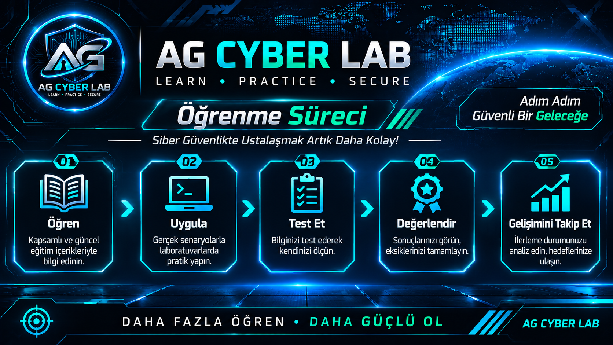

# AG CYBER LAB — Başlangıç Seviyesi

<p align="center">
  
</p>

<h1 align="center">ÖĞREN • UYGULA • GÜVENDE KAL</h1>

<p align="center">
  <strong>Uygulamalı ve Yerel Çalışan Bir Siber Güvenlik Eğitim Deneyimi</strong>
</p>

<p align="center">
  <a href="README.md">English</a> · <a href="README.tr.md">Türkçe</a>
</p>

<p align="center">
  
</p>

---

## Proje Hakkında

**AG CYBER LAB – Başlangıç Seviyesi**, siber güvenliğe yeni başlayanların sağlam bir teknik temel oluşturmasına yardımcı olmak amacıyla hazırlanmış yapılandırılmış bir eğitim projesidir.

Proje; bilgisayar bilimleri, ağ teknolojileri, işletim sistemleri, programlama, siber güvenlik kavramları, kriptografi, siber tehditler ve sanallaştırma alanlarını kapsayan **9 bağımsız eğitim modülünden** oluşur.

Her modül, katılımcının kendi bilgisayarında yerel olarak kurup çalıştırabileceği bağımsız bir uygulamadır.

Amacımız, yapılandırılmış eğitim içerikleri, etkileşimli öğrenme deneyimleri ve uygulamalı çalışmalar aracılığıyla siber güvenlik eğitimini daha erişilebilir hâle getirmektir.

## Projenin Öne Çıkan Özellikleri

| Özellik | Açıklama |
|---|---|
| 9 Bağımsız Modül | Başlangıç seviyesine yönelik yapılandırılmış eğitim programı |
| 110 Ders Başlığı | Temel teknik konuları kapsayan geniş içerik |
| Etkileşimli Öğrenme | Etkileşimli eğitim bileşenleri ve çalışmalar |
| Bilgi Değerlendirmeleri | Mini testler ve modül sonu değerlendirmeleri |
| Yerel Çalıştırma | Uygulamaları kendi bilgisayarında çalıştırabilme |
| Bağımsız Projeler | Her modülün kendine ait proje yapılandırması |
| Başlangıç Dostu | Teknik kavramların aşamalı olarak öğretilmesi |

## Eğitim Müfredatı — 9 Modül

<p align="center">
  
</p>

| No. | Eğitim Modülü | Temel Konular |
|---|---|---|
| 01 | Siber Güvenliğe Giriş | Güvenlik temelleri, güvenlik ekipleri, kariyer ve etik |
| 02 | Bilgisayar Bilimleri Temelleri | Bilgisayar mimarisi, donanım, yazılım ve veri |
| 03 | Ağ Teknolojileri Temelleri | Ağ modelleri, IP adresleme, protokoller ve portlar |
| 04 | İşletim Sistemleri Temelleri | Windows, Linux, süreçler, izinler ve komut satırı |
| 05 | Programlama ve Scripting Temelleri | Algoritmalar, Python, Bash, PowerShell ve veri formatları |
| 06 | Siber Güvenlik Temel Kavramları | CIA Triad, tehditler, zafiyetler, risk ve savunma |
| 07 | Kriptografi Temelleri | Şifreleme, hash, dijital imza ve PKI |
| 08 | Siber Tehditleri Tanıma | Zararlı yazılımlar, phishing, sosyal mühendislik ve saldırı kavramları |
| 09 | Sanallaştırma ve Laboratuvar Temelleri | Sanal makineler, hypervisor ve izole laboratuvar ortamları |

## Eğitim Deneyimi

<p align="center">
  
</p>

Eğitim deneyimi, teorik anlatımları uygulamalı ve etkileşimli bileşenlerle bir araya getirir.

Modüle bağlı olarak katılımcılar şu içeriklerle karşılaşabilir:

- Yapılandırılmış eğitim içerikleri
- Etkileşimli gösterimler
- Uygulamalı çalışmalar ve simülasyonlar
- Ders sonu bilgi kontrolleri
- Modül sonu değerlendirmeleri
- Öğrenme ilerlemesi özellikleri

Her uygulama bağımsız geliştirildiği için özellikler ve arayüzler modüller arasında farklılık gösterebilir.

## Öğrenme Süreci

<p align="center">
  
</p>

**Öğren → Uygula → Test Et → Değerlendir → Gelişimini Takip Et**

Bilgini adım adım geliştir. Kavramları keşfet, mevcut uygulamalı çalışmalarla pratik yap, öğrendiklerini değerlendir ve gelişmeye devam et.

## Uygulama Ekran Görüntüleri

Eğitim uygulamalarının gerçek ekran görüntüleri, görsel dokümantasyon tamamlandıkça bu bölüme eklenecektir.

## Kullanılan Teknolojiler

Modüller kendi teknoloji tercihlerini koruyacak şekilde hazırlanmıştır.

- **Next.js:** Modüllerin büyük bölümünde kullanılan framework.
- **React:** Bileşen tabanlı kullanıcı arayüzleri.
- **TypeScript:** Tip güvenli uygulama geliştirme.
- **Vite:** 02 numaralı modülde kullanılan geliştirme aracı.
- **Tailwind CSS:** Kullanan projelerde yardımcı stil sistemi.
- **npm:** Bağımlılık kurulumu ve proje komutları.

Modüller tek bir uygulama altında birleştirilmemiştir. Her modülün kendine ait `package.json` dosyası ve geliştirme komutları bulunur.

## Sistem Gereksinimleri

Başlamadan önce aşağıdakilerin bilgisayarında kurulu olduğundan emin ol:

- Windows, macOS veya Linux
- Desteklenen güncel bir Node.js LTS sürümü
- npm (Node.js ile birlikte gelir)
- Güncel bir web tarayıcısı
- İlk bağımlılık kurulumu için internet bağlantısı

## Kurulum ve Hızlı Başlangıç

### 1. Depoyu İndir

Depoyu Git üzerinden klonla:

```bash
git clone <REPOSITORY-URL>
```

Alternatif olarak GitHub üzerinden ZIP dosyasını indirip çıkartabilirsin.

### 2. Bir Modül Seç

`modules/` klasörünü aç ve çalışmak istediğin eğitim modülünü seç.

### 3. Terminali Aç

Seçtiğin modülün kendi klasörü içerisinde terminal aç.

### 4. Bağımlılıkları Kur

```bash
npm install
```

### 5. Uygulamayı Başlat

```bash
npm run dev
```

### 6. Yerel Uygulamayı Aç

Terminalde gösterilen yerel adresi tarayıcında aç.

Yaygın geliştirme adresleri:

- Next.js: `http://localhost:3000`
- Vite: `http://localhost:5173`

Varsayılan port kullanımda ise uygulama farklı bir port üzerinden başlayabilir.

**Önemli:** Her modül bağımsızdır. Komutları depo ana klasöründe değil, seçtiğin modülün kendi klasöründe çalıştırmalısın. Portları ayrıca yapılandırmadığın sürece aynı anda tek bir modül çalıştırmanı öneririz.

## Depo Klasör Yapısı

```text
AG-CYBER-LAB-BEGINNER/
│
├── assets/
│   └── images/
│
├── docs/
│
├── modules/
│   ├── 01-siber-guvenlige-giris/
│   ├── 02-bilgisayar-bilimleri-temelleri/
│   ├── 03-ag-teknolojileri-temelleri/
│   ├── 04-isletim-sistemleri-temelleri/
│   ├── 05-programlama-ve-scripting-temelleri/
│   ├── 06-siber-guvenlik-temel-kavramlari/
│   ├── 07-kriptografi-temelleri/
│   ├── 08-siber-tehditleri-tanima/
│   └── 09-sanallastirma-ve-laboratuvar/
│
├── .gitignore
├── CONTRIBUTING.md
├── LICENSE
├── README.md
├── README.tr.md
└── SECURITY.md
```

Her modül kendi uygulama kaynak kodlarını, yapılandırma dosyalarını, bağımlılıklarını ve çalıştırma komutlarını içerir.

## Yerel Çalışma Mimarisi

AG CYBER LAB Başlangıç Seviyesi, bağımsız yerel uygulamalar üzerine tasarlanmıştır.

- Bir modülü başlatmak için merkezi bir katılımcı hesabı gerekmez.
- AG CYBER LAB tarafından barındırılan bir platforma ihtiyaç duyulmaz.
- İlerleme verileri, uygulandığı modüllerde tarayıcının yerel depolama alanında tutulur.
- Tarayıcı verilerinin temizlenmesi kaydedilmiş ilerlemenin silinmesine neden olabilir.
- Bu depo merkezi bulut senkronizasyonu sağlamaz.

Modüle özel davranışlar için ilgili modülün dokümantasyonunu incele.

## Güvenlik ve Etik Kullanım

Bu proje eğitim amacıyla hazırlanmıştır.

- Uygulamalı çalışmaları yalnızca tasarlandıkları eğitim ortamlarında kullan.
- Açık iznin olmadan sistemleri, ağları, hesapları veya hizmetleri test etme.
- Eğitim bilgilerini hukuka aykırı erişim, kesinti veya zarar verme amacıyla kullanma.
- Yürürlükteki yasalara ve sorumlu güvenlik bildirim süreçlerine uy.

Güvenlikle ilgili bildirimler için [SECURITY.md](SECURITY.md) dosyasını incele.

## Dokümantasyon

- [English Documentation](README.md)
- [Türkçe Dokümantasyon](README.tr.md)
- [Kurulum Rehberi](docs/INSTALLATION.md)
- [Proje Yapısı](docs/PROJECT-STRUCTURE.md)
- [Güvenlik Politikası](SECURITY.md)
- [Katkı Rehberi](CONTRIBUTING.md)
- [Lisans](LICENSE)

## Katkıda Bulunma

Öneriler, dokümantasyon iyileştirmeleri, hata bildirimleri ve eğitim odaklı katkılar memnuniyetle karşılanır.

Katkıda bulunmadan önce [CONTRIBUTING.md](CONTRIBUTING.md) dosyasını incele.

## Lisans

Kullanım, yeniden dağıtım ve ticari kullanım koşulları için [LICENSE](LICENSE) dosyasını incele.

## AG CYBER LAB Hakkında

**AG CYBER LAB**, siber güvenlik kavramlarını yapılandırılmış eğitim ve uygulamalı keşif yoluyla daha anlaşılır hâle getirmeyi amaçlayan bir eğitim projesidir.

**LEARN • PRACTICE • SECURE**

- Instagram: [@agcyberlab](https://www.instagram.com/agcyberlab/)
- Kurucu: [@ahmetgulerpy](https://www.instagram.com/ahmetgulerpy/)

---

<p align="center">
  <strong>AG CYBER LAB — Başlangıç Seviyesi</strong>
  <br>
  Bugün öğren. Sorumlu şekilde uygula. Daha güvenli bir dijital gelecek oluştur.
</p>

<p align="center">
  Eğitim amaçlı projedir. Modüllerin içerikleri, özellikleri ve uygulama detayları farklılık gösterebilir.
</p>